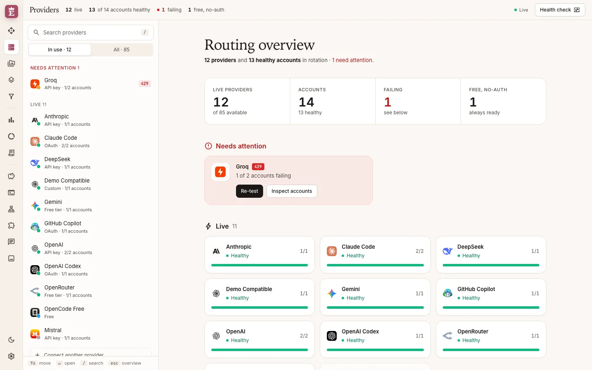
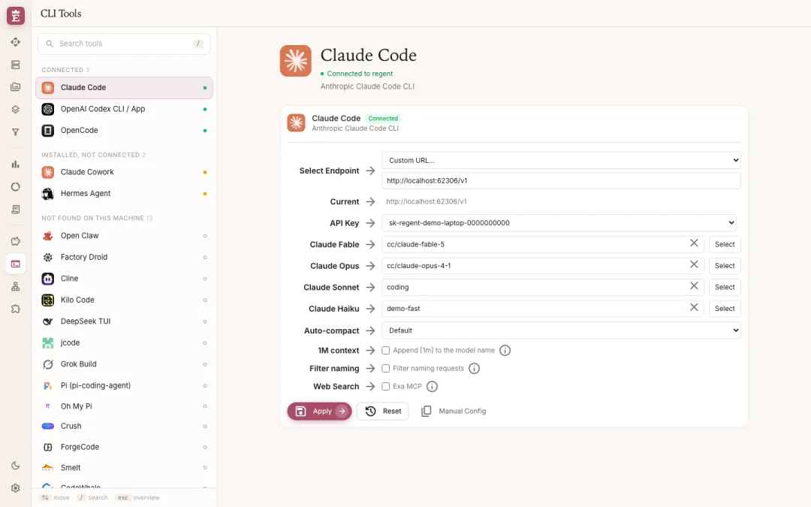
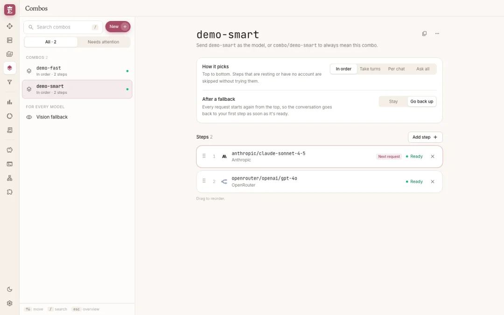
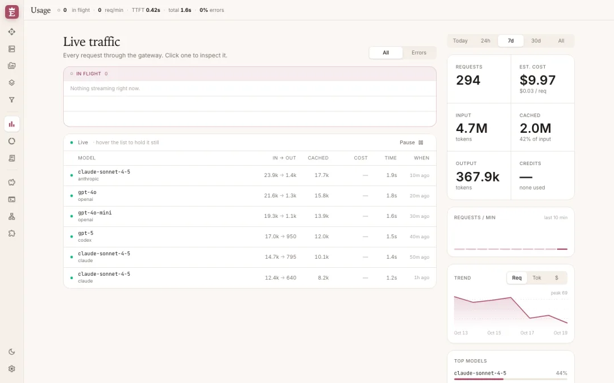
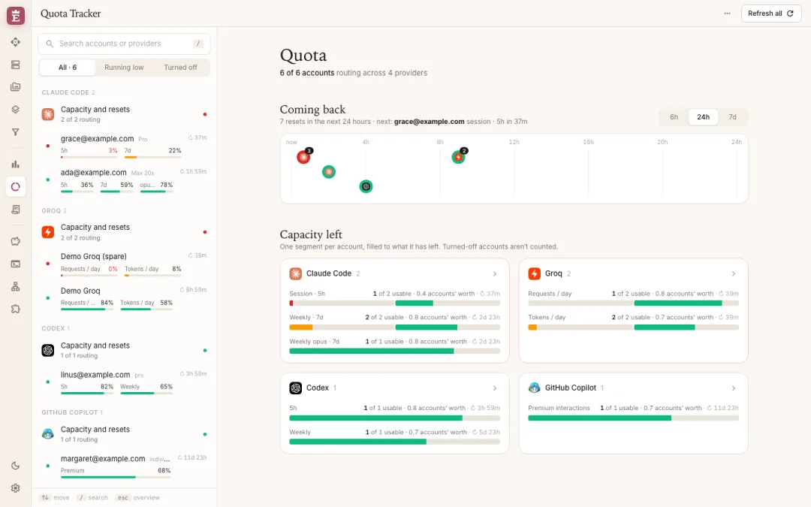
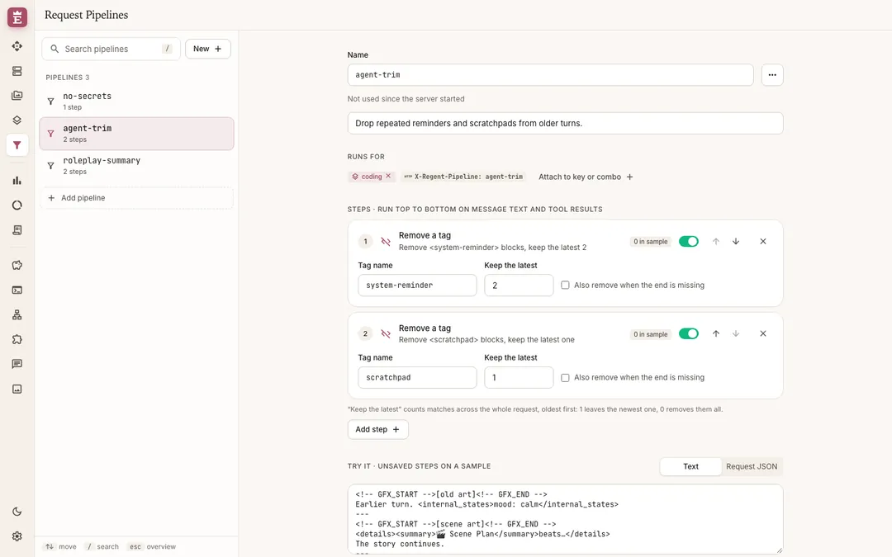
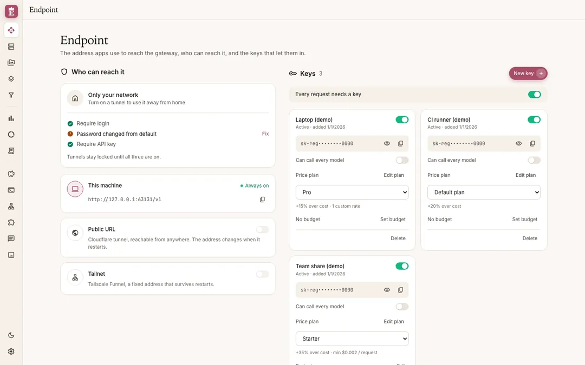

<div align="center">
  

  # Elizabeth's Proxy

  One local, OpenAI-compatible endpoint that routes your AI tools across 40+ providers and all your accounts, with fallback when one runs dry.
</div>

<picture>
  <source media="(prefers-color-scheme: dark)" srcset="docs/images/readme/hero-dark.webp">
  
</picture>

Point Claude Code, Codex, Cursor, Cline, OpenCode or any OpenAI-compatible client at `http://localhost:20128/v1`. For every request, Elizabeth's Proxy picks a provider and account, translates between API formats, falls back when something fails, and shows you live what's healthy.

The command, package, data folder and Docker image are called `regent`.

## Quick start

### Docker

```bash
docker run -d --name regent -p 20128:20128 \
  -e INITIAL_PASSWORD='pick-a-real-password' \
  -e JWT_SECRET="$(openssl rand -hex 32)" \
  -v regent-data:/app/data \
  ghcr.io/leon-marzahn/regent:100
```

Open <http://localhost:20128/dashboard>, sign in, add a provider. The API is at `http://localhost:20128/v1`.

Images are multi-arch (amd64, arm64). Tags follow [epoch semver](https://antfu.me/posts/epoch-semver):

| Tag | Tracks |
| --- | --- |
| `100.2.3` | exactly that release |
| `100.2` | newest patch of 100.2 |
| `100` | newest release in major 100, no breaking changes (recommended) |
| `latest` | newest stable release, including new majors |

### From source

Needs Node (version in `.node-version`) to run and [Bun](https://bun.sh) 1.3+ to install.

```bash
cp .env.example .env          # set INITIAL_PASSWORD and JWT_SECRET
bun install
bun run build
PORT=20128 bun run start      # dashboard: http://localhost:20128/dashboard
```

For development: `PORT=20128 NEXT_PUBLIC_BASE_URL=http://localhost:20128 bun run dev`.

> [!IMPORTANT]
> The default `INITIAL_PASSWORD` is `123456`. Change it before the server is reachable from anywhere but your own machine.

The `regent` CLI launcher (tray icon, auto-start) lives in [`cli/`](cli/) and isn't on npm yet.

## Connect your tools

Open **CLI Tools** in the dashboard, pick a tool, choose an endpoint, API key and models, and click **Apply**. It writes the tool's own config file and keeps a backup, so **Reset** puts it back. Tools it can't write to get a paste-ready **Manual Config**.



Anything else: use base URL `http://localhost:20128/v1` and a key from **Endpoint**. Models are addressed as `provider/model` (for example `anthropic/claude-sonnet-4-5`) or by a combo name.

## What it does

**Routing**

- **Combos.** Name a list of models and send that name as the model. Steps run in order, take turns, run per chat, or are all asked at once. After a fallback a combo can stay on the step that worked or go back up. Each step shows whether it's ready, and resting steps are skipped without a request.

  

- **Multi-account fallback.** Several accounts per provider rotate; one that hits a limit cools down per model and the next takes over. A conversation sticks to the same account while it can, so the provider's prompt cache keeps getting hits.
- **Format translation.** Clients speak OpenAI Chat, OpenAI Responses, Anthropic Messages or Gemini; the proxy translates to whatever the upstream speaks (including Kiro, Cursor, Vertex, Ollama and others), streaming included.

**Accounts and providers**

- **OAuth and API keys.** Sign in with subscription accounts via OAuth or paste API keys; tokens refresh on their own. Free, no-auth providers work out of the box.
- **Media providers.** Speech, transcription, embeddings, image, video and music generation, web search and fetch, each with its own providers and combos.
- **TLS fingerprint impersonation (opt-in).** Per connection, upstream calls can present a Chrome, Edge, Firefox, Safari or OkHttp TLS/HTTP2 fingerprint (via the optional `wreq-js` package).

**Seeing what happens**

- **Usage.** Every request live: model, provider, tokens in/out, cache hits, cost, latency, errors, with a drawer for the full request. Totals and trends by day, week or month.

  

- **Quota.** Remaining limits per subscription account (Claude Code, Codex, GitHub Copilot, Groq and others that report them): session and weekly windows, a timeline of upcoming resets, and capacity left across all accounts of a provider.

  

**Shaping requests**

- **Request pipelines.** Steps that clean requests before they reach a provider: strip tags or sections, redact keys and tokens, custom regex. Attach a pipeline to an API key or combo, or pick one per request with the `X-Regent-Pipeline` header; a live preview shows what changes.

  

- **Token saver.** Compresses tool output (command logs, file listings, diffs) before the model sees it. If anything goes wrong it leaves the request untouched.

**Reaching it**

- **Endpoint.** API keys for your clients, an optional "every request needs a key" switch, and optional Cloudflare or Tailscale tunnels. Tunnels stay locked until login, a changed password and API keys are all on.

  

- **Update notices.** About once a day the dashboard checks GitHub for a newer release and shows a quiet notice. Only the version list is fetched. Optionally it can call a redeploy webhook (Coolify, Portainer, Dokploy…) when a new version lands; set it up in **Settings → Updates**. `REGENT_UPDATE_CHECK=false` turns both off. Details, image tags and a Coolify example: [`docs/UPDATES.md`](docs/UPDATES.md).

## Security

- **Local by default.** Data stays on your machine in `~/.regent` (`%APPDATA%\regent` on Windows), or `DATA_DIR`. Nothing is reachable from the internet unless you start a tunnel or expose the port yourself.
- **Change the password.** Set `INITIAL_PASSWORD`, and set `JWT_SECRET` to a long random value. Also set `API_KEY_SECRET` and `MACHINE_ID_SALT` for a deployment you keep. The full list is in [`.env.example`](.env.example).
- **Require API keys** (the switch on the Endpoint page) whenever anything other than your own machine can reach the port.
- Behind a reverse proxy, `X-Forwarded-For` is trusted only from a loopback proxy.
- Secrets such as the redeploy webhook token are never shown again or returned by the API, and are left out of backups.
- **Login off means this machine only.** With "Require login" off, only a browser on the same machine (loopback peer, loopback Origin, no proxy or tunnel in between) skips login; everyone else, including LAN, Docker-by-host-IP, reverse-proxy, tunnel and Tailscale users, still needs to sign in. Login is waived only when the Host is `localhost`, `127.0.0.1` or `[::1]` and no forwarding header (`X-Forwarded-*`, `X-Real-IP`, `Forwarded`, `Via`, `CF-Connecting-IP`) is present. **Don't turn login off behind a reverse proxy on the same machine that adds none of these** (nginx's bare `proxy_pass` sends `Host: 127.0.0.1` and no forwarding headers): its traffic looks local.
- **Host allow-list.** The dashboard and `/api` answer only to `localhost`, `127.0.0.1`, `[::1]`, IP addresses, the `BASE_URL` / `NEXT_PUBLIC_BASE_URL` host, the active tunnel and Tailscale hosts, and names in `ALLOWED_HOSTS`; any other Host gets 421, which blocks DNS rebinding. Behind a reverse proxy or under a LAN name, add that name to `ALLOWED_HOSTS`. `/v1` with an API key works under any Host.

## Docs

- [`docs/ARCHITECTURE.md`](docs/ARCHITECTURE.md): request lifecycle, fallback, OAuth and token refresh, data model.
- [`docs/DESIGN.md`](docs/DESIGN.md): the dashboard's design system.
- [`docs/UPDATES.md`](docs/UPDATES.md): update notices, image tags, the redeploy webhook.
- [`CHANGELOG.md`](CHANGELOG.md): what changed in each release.
- [`CLAUDE.md`](CLAUDE.md): commands, tests and conventions for contributors.

## Credits

Elizabeth's Proxy started as a fork of [9Router](https://github.com/decolua/9router) by decolua and contributors, and is now developed independently. Installs from before the rename are moved over from `~/.9router` on first start. It builds on [CLIProxyAPI](https://github.com/router-for-me/CLIProxyAPI), [RTK](https://github.com/rtk-ai/rtk), [Caveman](https://github.com/JuliusBrussee/caveman) and [Ponytail](https://github.com/DietrichGebert/ponytail).

## License

MIT. See [LICENSE](LICENSE).
