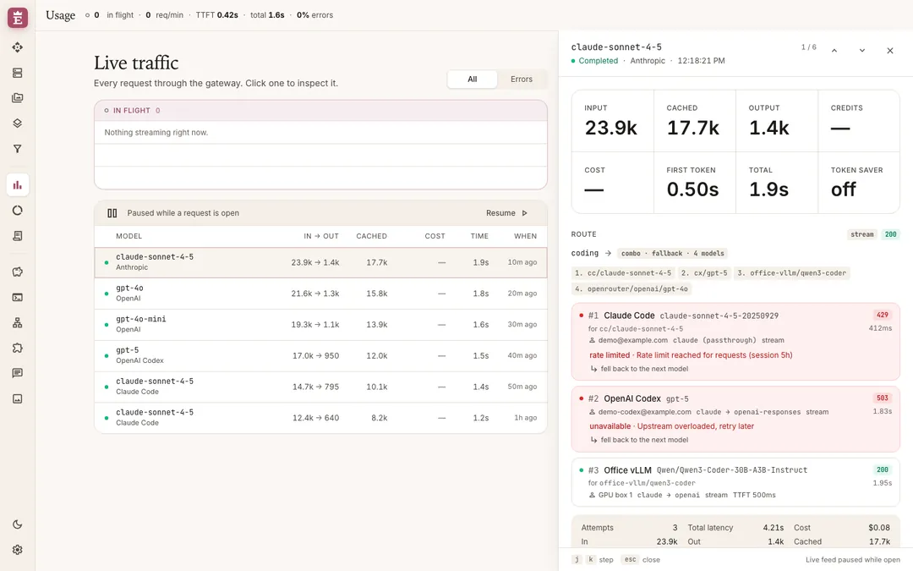
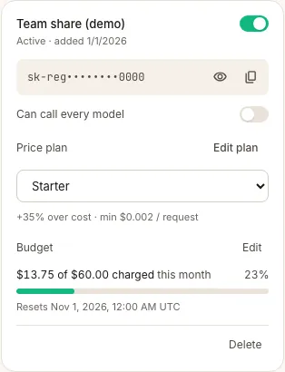
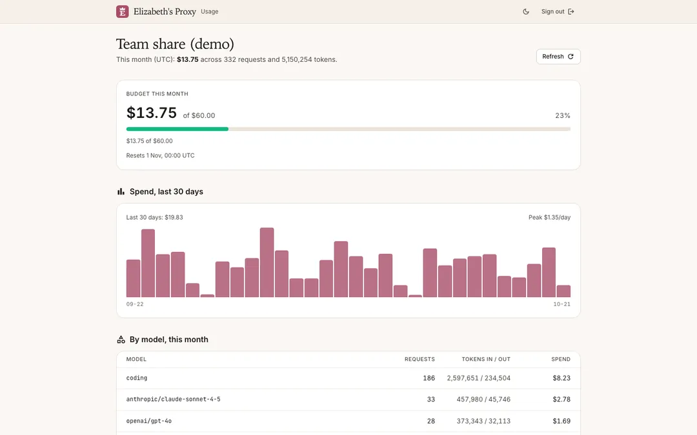

<div align="center">
  

  # Elizabeth's Proxy

  One local, OpenAI-compatible endpoint that routes your AI tools across 40+ providers and all your accounts, with fallback when one runs dry.
</div>

<picture>
  <source media="(prefers-color-scheme: dark)" srcset="docs/images/readme/hero-dark.webp">
  
</picture>

Point Claude Code, Codex, Cursor, Cline, OpenCode or any OpenAI-compatible client at `http://localhost:20128/v1`. For every request, Elizabeth's Proxy picks a provider and account, translates between API formats, falls back when something fails, and records what happened. You can also hand out API keys to other people, price their usage and cap their spend.

The command, package, data folder and Docker image are called `regent`.

## Quick start

### Docker

```bash
docker run -d --name regent -p 20128:20128 \
  -e INITIAL_PASSWORD='pick-a-real-password' \
  -e JWT_SECRET="$(openssl rand -hex 32)" \
  -v regent-data:/app/data \
  ghcr.io/leon-marzahn/regent:102
```

Open <http://localhost:20128/dashboard>, sign in, add a provider. The API is at `http://localhost:20128/v1`.

> [!IMPORTANT]
> Provider credentials are encrypted at rest. On first start the key is generated into the data folder as `credentials.key`. **Back it up together with the database**: without it the stored credentials can't be read. To manage the key yourself, set `CREDENTIALS_KEY` (32 bytes, e.g. `openssl rand -base64 32`) instead.

Images are multi-arch (amd64, arm64). Tags follow [epoch semver](https://antfu.me/posts/epoch-semver):

| Tag | Tracks |
| --- | --- |
| `102.0.1` | exactly that release |
| `102.0` | newest patch of 102.0 |
| `102` | newest release in major 102, no breaking changes (recommended) |
| `latest` | newest stable release, including new majors |

Older majors keep getting fixes for a while: backports are released from `support/v<major>` branches and move that major's tags, never `latest`. More in [`docs/UPDATES.md`](docs/UPDATES.md).

### From source

Needs Node (version in `.node-version`) to run and [Bun](https://bun.sh) 1.3+ to install.

```bash
cp .env.example .env          # set INITIAL_PASSWORD, JWT_SECRET and DATA_DIR
bun install
bun run build
PORT=20128 bun run start      # dashboard: http://localhost:20128/dashboard
```

For development: `PORT=20128 NEXT_PUBLIC_BASE_URL=http://localhost:20128 bun run dev`.

### Configuration

The full list, with comments, is in [`.env.example`](.env.example). The ones that matter for a deployment you keep:

| Variable | What it does |
| --- | --- |
| `INITIAL_PASSWORD` | Dashboard password on first start. The default is `123456`: change it. |
| `JWT_SECRET` | Signs the session cookie. Set a long random value. |
| `DATA_DIR` | Where the database lives (default `~/.regent`, `/app/data` in Docker). |
| `CREDENTIALS_KEY` | Encryption key for stored credentials. Unset: `DATA_DIR/credentials.key` is generated and used. |
| `CREDENTIALS_KEY_PREVIOUS` | Old keys during a rotation (`vp run rotate-credentials-key`). |
| `API_KEY_SECRET`, `MACHINE_ID_SALT` | Server-side secrets with placeholder defaults. Set your own. |
| `TRUSTED_PROXIES` | Reverse proxies besides loopback whose `X-Forwarded-For` is believed. |
| `REGENT_UPDATE_CHECK` | `false` turns off the daily release check. |

The `regent` CLI launcher (tray icon, auto-start) lives in [`cli/`](cli/) and isn't on npm yet.

## Connect your tools

Open **CLI Tools** in the dashboard, pick a tool, choose an endpoint, API key and models, and click **Apply**. It writes the tool's own config file and keeps a backup, so **Reset** puts it back. Tools it can't write to get a paste-ready **Manual Config**.


Anything else: use base URL `http://localhost:20128/v1` and a key from **Endpoint**. Models are addressed as `provider/model` (for example `anthropic/claude-sonnet-4-5`) or by a combo name.

## What it does

### Routing

- **Combos.** Name a list of models and send that name as the model. Steps run in order, take turns, run per chat, or are all asked at once. After a fallback a combo can stay on the step that worked or go back up. Resting steps are skipped without a request.

  

- **Multi-account fallback.** Several accounts per provider rotate; one that hits a limit cools down per model and the next takes over. A conversation sticks to the same account while it can, so the provider's prompt cache keeps getting hits.
- **Format translation.** Clients speak OpenAI Chat, OpenAI Responses, Anthropic Messages or Gemini; the proxy translates to whatever the upstream speaks (including Kiro, Cursor, Vertex, Ollama and others), streaming included.
- **OAuth and API keys.** Sign in with subscription accounts via OAuth or paste API keys; tokens refresh on their own. Free, no-auth providers work out of the box.
- **Media providers.** Speech, transcription, embeddings, image, video and music generation, web search and fetch, each with its own providers and combos.
- **Request pipelines.** Steps that clean requests before they reach a provider: strip tags or sections, redact keys and tokens, custom regex. Attach one to an API key or combo, or pick it per request with the `X-Regent-Pipeline` header.

  

- **Token saver.** Compresses tool output (command logs, file listings, diffs) before the model sees it. If anything goes wrong it leaves the request untouched.
- **TLS fingerprint impersonation (opt-in).** Per connection, upstream calls can present a Chrome, Edge, Firefox, Safari or OkHttp TLS/HTTP2 fingerprint (via the optional `wreq-js` package).

### Observability

- **Live traffic and usage.** Every request as it happens: model, provider, tokens in/out, cache hits, cost, latency, errors. Totals and trends by day, week or month.

  

- **Request inspector.** Click a request to see its route: which combo step and account were tried, why each one failed, and which one answered.

  

- **Quota.** Remaining limits per subscription account (Claude Code, Codex, GitHub Copilot, Groq and others that report them): session and weekly windows, a timeline of upcoming resets, and capacity left across all accounts of a provider.

  

- **Playground.** Chat with a connected model from the dashboard to try it out.

### Keys, pricing and budgets

- **Price plans per key.** Each key is charged by a plan: a markup over upstream cost, an optional minimum per request, and custom per-model rates. Usage records both what you pay (cost) and what the key is charged.
- **Budgets.** Per key (on what it's charged) and global (on what you pay), per day or month: spend, token and request limits, warnings at chosen percentages, and an optional hard stop that refuses requests once a limit is reached. Alerts go out by email over SMTP or Resend, to you and optionally to the key's holder.

  

- **Customer view.** At `/customer`, a key holder enters their key to see their own spend, budget, daily chart and recent requests. It shows the model name they asked for, never the provider, account or your cost. Off unless you turn it on in **Settings**, and can be blocked per key.

  

### Reaching it

- **Endpoint.** API keys for your clients, a "every request needs a key" switch, and optional Cloudflare or Tailscale tunnels. Tunnels stay locked until login, a changed password and API keys are all on.

  

- **Update notices.** About once a day the dashboard checks GitHub for a newer release and shows a quiet notice. Only the version list is fetched. Optionally it calls a redeploy webhook (Coolify, Portainer, Dokploy…) when a new version lands; set it up in **Settings → Updates**. Details: [`docs/UPDATES.md`](docs/UPDATES.md).

## Security

- **Local by default.** Data stays on your machine in `~/.regent` (`%APPDATA%\regent` on Windows), or `DATA_DIR`. Nothing is reachable from the internet unless you start a tunnel or expose the port yourself.
- **Login and keys on by default.** The dashboard requires login and the API requires a key out of the box. Routes that write tool configs, start tunnels or install software are limited to the local machine (or the local CLI's token).
- **Login off means this machine only.** With "Require login" off, only a browser on the same machine (loopback peer, loopback Origin, no proxy or tunnel in between) skips login; everyone else, including LAN, Docker-by-host-IP, reverse-proxy, tunnel and Tailscale users, still needs to sign in.
- **Host allow-list.** The dashboard and `/api` answer only to `localhost`, `127.0.0.1`, `[::1]`, IP addresses, the `BASE_URL` / `NEXT_PUBLIC_BASE_URL` host, the active tunnel and Tailscale hosts, and names in `ALLOWED_HOSTS`; any other Host gets 421, which blocks DNS rebinding. Behind a reverse proxy or under a LAN name, add that name to `ALLOWED_HOSTS`. `/v1` with an API key works under any Host.
- **Change the defaults.** Set `INITIAL_PASSWORD`, a long random `JWT_SECRET`, and your own `API_KEY_SECRET` and `MACHINE_ID_SALT`.
- **Credentials encrypted at rest.** Provider API keys and OAuth tokens, proxy passwords and notification and SSO secrets are stored with AES-256-GCM. The key is `CREDENTIALS_KEY` or `DATA_DIR/credentials.key`; without it the server refuses to start rather than fall back to plaintext. Rotate it with `vp run rotate-credentials-key`. Not encrypted: client API keys, the password-protected DB export, and the config files the CLI Tools page writes.
- **Secrets stay out of responses and logs.** Stored secrets are never sent back by the API (it reports only that one is set) and are left out of backups. Keys, tokens and cookies are redacted in request logs and debug output.
- **Forwarded headers.** `X-Forwarded-For` is trusted only from a loopback proxy, or from the hosts listed in `TRUSTED_PROXIES`.
- **Pinned PXPIPE.** The optional PXPIPE install is pinned to one version and hash; a copy that doesn't match is not loaded.

## Docs

- [`docs/ARCHITECTURE.md`](docs/ARCHITECTURE.md): request lifecycle, fallback, OAuth and token refresh, data model.
- [`docs/DESIGN.md`](docs/DESIGN.md): the dashboard's design system.
- [`docs/UPDATES.md`](docs/UPDATES.md): update notices, image tags, the redeploy webhook.
- [`CHANGELOG.md`](CHANGELOG.md): what changed in each release.
- [`CLAUDE.md`](CLAUDE.md): commands, tests and conventions for contributors. README screenshots are retaken from demo data with `bun run readme:shots`.

## Credits

Elizabeth's Proxy started as a fork of [9Router](https://github.com/decolua/9router) by decolua and contributors, and is now developed independently. Installs from before the rename are moved over from `~/.9router` on first start. It builds on [CLIProxyAPI](https://github.com/router-for-me/CLIProxyAPI), [RTK](https://github.com/rtk-ai/rtk), [Caveman](https://github.com/JuliusBrussee/caveman) and [Ponytail](https://github.com/DietrichGebert/ponytail).

## License

MIT. See [LICENSE](LICENSE).
